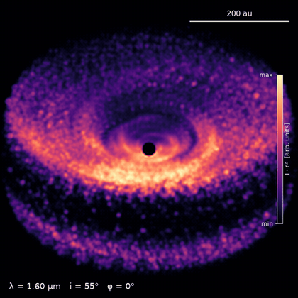
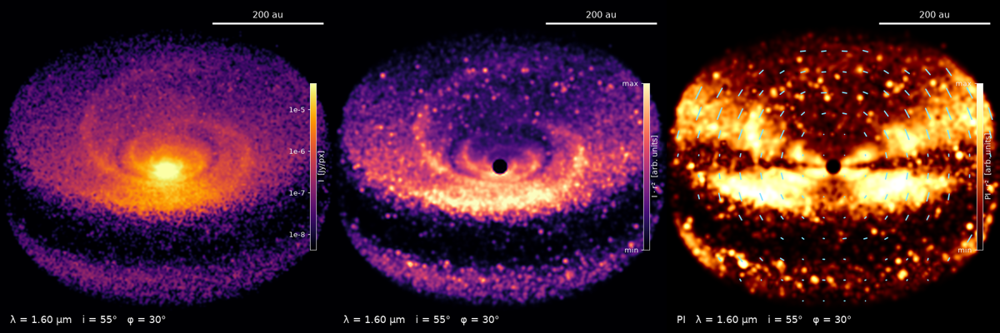

# hamster-animator

Good-looking animations of protoplanetary disks, rendered from Monte Carlo radiative transfer simulations with [HAMSTER](https://github.com/muellxr/HAMSTER).

<p align="center"></p>

You describe **what** to show (a disk, a camera path, wavelengths, Stokes quantities) and hamster-animator
works out **which** HAMSTER runs are needed, runs them locally or on SLURM, caches every detector map and
renders the video.

```python
import hamster_animator as ha

disk = ha.presets.showcase()                     # spiral arms + planet + vortex
camera = ha.Camera.orbit(inclination=55, frames=72).then(ha.Camera.tilt(to=80, frames=24))

anim = ha.Animation(disk, camera, wavelength=1.6e-6, sim=ha.Sim(photons=3e5))
anim.draft().save("preview.mp4")                 # quick look: 10x fewer photons
anim.save("orbit.mp4", style="cinematic")        # final quality
```

## Features

- **Camera flights**: orbit, tilt, zoom, roll, flyby and arbitrary moves, chained with `.then()`, with easing
- **Wavelength journeys** with cross-fades, and **RGB composites** from three wavelengths
- **Polarisation**: I, Q, U, V, PI, polarisation degree, Q_φ/U_φ, polarisation vectors
- **Parameter evolution**: sweep any disk or structure parameter; steps are cross-faded
- **Disk models**: Shakura-Sunyaev disk with spirals, gaps, planets, clumps/vortices and warps
- **Efficient**: views are de-duplicated, wavelengths and Stokes come from the same run, results are cached per view and wavelength
- **Local or SLURM**, output to MP4, WebM, GIF, ProRes or PNG sequences

<p align="center"></p>
<p align="center"><sub>One frame in the <code>dark</code>, <code>cinematic</code> and <code>polarimetry</code> (polarised intensity with vectors) styles.</sub></p>

## Installation

hamster-animator drives an existing HAMSTER installation. You need

1. a compiled HAMSTER checkout (`./compile.sh`, see the HAMSTER README),
2. the HAMSTER Python tools, installed from that checkout: `python -m pip install -e .`,
3. `ffmpeg` for video output (PNG sequences work without it).

Then install this package:

```bash
python -m pip install git+https://github.com/C0MaE/hamster-animator.git
```

Check that everything is found:

```bash
hamster-animator info
```

The HAMSTER root is detected from the installed tools. Otherwise set `HAMSTER_ROOT=/path/to/HAMSTER`
or pass `Local(hamster="/path/to/HAMSTER")`.

## Try the gallery

```bash
hamster-animator gallery orbit --draft         # a few minutes on a laptop
hamster-animator gallery all --plan            # show what every example would compute
hamster-animator gallery polarization          # full quality
```

Examples: `orbit`, `flyby`, `spectrum`, `rgb`, `polarization`, `evolution`. Videos end up in `./animations/`.
More scripts are in [`examples/`](examples).

## Concepts

An `Animation` combines four **tracks**. A track of length 1 is held for the whole animation; all other
tracks must have the same length.

| track        | value                                             | example                                                               |
|--------------|---------------------------------------------------|-----------------------------------------------------------------------|
| `scene`      | `Disk` or `Steps([Disk, …])`                      | `Steps(disk.sweep("planet.azimuth", range(0, 360, 30)), fade=3, loop=True)` |
| `camera`     | `View` or a camera `Path`                         | `Camera.orbit(frames=72).then(Camera.zoom(to=200, frames=24))`        |
| `wavelength` | metres, `(r, g, b)` for RGB, or `Steps([...])`    | `Steps([0.5e-6, 1.6e-6, 870e-6], hold=12, fade=8)`                    |
| `quantity`   | `"I"`, `"PI"`, `"P"`, `"Q_PHI"`, … or `Steps`     | `Steps(["I", "PI", "Q_PHI"], hold=20, fade=10)`                       |

`Steps` cross-fades between neighbouring values in image space, so smooth transitions cost no simulation time.

### Scenes

```python
disk = ha.Disk(r_out=250, h_ref=8, alpha=2.0, beta=1.2, dust_mass=1e-4,
               structures=(ha.Planet(radius=45), ha.Warp(r_break=15, tilt=12)))
disk.with_(beta=1.1)                              # variant
disk.with_(**{"planet.radius": 60})               # change a structure parameter
disk.sweep("planet.gap_depth", [0.5, 0.8, 0.99])  # list of variants
```

Structures: `Spiral`, `Gap`, `Planet` (gap + clump + wake), `Clump` (a vortex with `elongation > 1`),
`Warp` (tilted inner disk that casts shadows). Presets: `smooth`, `spiral`, `planet`, `warped`, `showcase`.
Lengths are in au and angles in degrees. Grids are built vectorised in milliseconds.

### Camera

`Camera.orbit`, `tilt`, `zoom`, `roll`, `flyby`, `move(frames, **params)`, `still`, `views([...])`.
A segment keeps every parameter it does not set from the end of the previous segment.
Easings: `linear`, `in`, `out`, `in_out`, `sine`, `expo`. `path * 2` repeats a path, `path.boomerang()` plays it forward and back.

### Styles

Presets `dark`, `cinematic`, `paper`, `polarimetry` and `ice`, or your own `Style(...)`. Adjust a preset with `.with_(...)`:

```python
style = ha.STYLES["cinematic"].with_(colormap="inferno", title="My disk", size=(1920, 1080))
```

The most useful options:

| option | effect |
|---|---|
| `stretch=Stretch("log" \| "asinh" \| "sqrt" \| "linear", lo, hi, ...)` | brightness scaling |
| `r2` | scale by r², makes the outer disk visible |
| `coronagraph` | mask around the star (au) |
| `smooth`, `temporal` | spatial / frame-to-frame denoising |
| `vectors` | polarisation vectors |
| `norm` | normalise per `"group"` (quantity + wavelength), `"global"` or `"frame"` |
| `label` | `"auto"`, a format string with `{lam} {inc} {az} {q} {params}`, or a function |
| `scalebar`, `colorbar`, `vignette`, `gamma` | overlays and finishing |

Handy for tuning: `anim.still("look.png", frame=10, style=...)` and `anim.contact_sheet("sheet.png")`.
Re-rendering never re-runs HAMSTER.

## Performance

Measured on a structured disk with 16 threads: every photon package interacts about 50 times, and each
interaction sends a peel-off ray to **every** detector. Runtime therefore grows linearly with the number of
detectors (about 11 s per view at 3·10⁵ photons and 192 px). hamster-animator keeps that number small:

- identical views are simulated once; for axisymmetric disks the azimuth is ignored, so an orbit costs one view
- all wavelengths and Stokes components of a view come from the same run
- dust heating runs once per scene, and thermal dust emission is only simulated where it matters (λ ≥ 2 µm)
- the cache works per (scene, settings, view, wavelength): a longer path or an extra wavelength only computes what is missing
- `smooth` and `temporal` denoising in the renderer allow fewer photons

Because cost is linear in views, SLURM scales linearly too:

```python
backend = ha.Slurm(partition="long", time="12:00:00", cpus=64, views_per_job=6)
anim.save("orbit.mp4", backend=backend)   # submits heating + scattering job arrays and returns
anim.save("orbit.mp4", backend=backend)   # after the jobs finish: collects the results and renders
```

The cache lives in `~/.cache/hamster-animator` (override with `HAMSTER_ANIMATOR_CACHE` or `Animation(..., cache=...)`).
`hamster-animator info` shows its size, `hamster-animator clear-cache` deletes it.

## Development

```bash
python -m pip install -e ".[dev]"
pytest
ruff check src tests
```

The tests do not need HAMSTER; the renderer is tested with synthetic Stokes maps.

## License

GPL-3.0-or-later, like HAMSTER. See [LICENSE](LICENSE).
